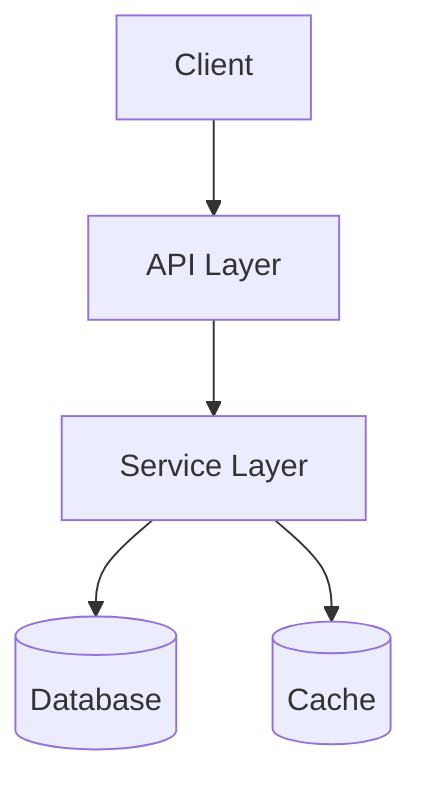
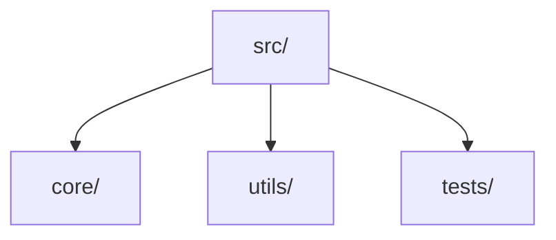

hi iam


## My Project Logo


# My Project Title

I created this project to [briefly explain purpose]. It solves [specific problem] by [your solution approach].

## Key Focus Areas

- Primary goal I achieved: [main accomplishment]
- Unique value I provide: [key differentiator]


## Table of Contents

Here's how I've organized my README:

- [Project Overview](#project-details)
- [Features I Built](#features)
- [How to Install](#installation)
- [Usage Examples](#usageexamples)
- [How to Contribute](#contributing)
- [License Information](#license)

*Remember to update these links to match your actual section headings*


## Badges

I've earned these recognitions: [](https://choosealicense.com/licenses/mit/)[](https://www.npmjs.com/package/my-package)[](https://github.com/MYUSER/REPO/actions)


## 🚀 About Me

I'm a [Your Title] specializing in [key technologies]. I've been developing solutions for [X] years, with expertise in [your niche]. Currently, I'm building [current project] while learning [new skills].


### 👋 I'm [Your Name]

I'm a passionate [Your Role] building [what you build]. My focus is on [your specialties].


## 🛠️ My Toolkit

**Languages:**

  

**Frameworks:**

  

**DevOps:**

  

**Design:**

 


## Contributors

Thanks to these wonderful people for contributing:

[](https://github.com/YOUR_GITHUB_USERNAME/YOUR_REPO_NAME/graphs/contributors)


---

If you like this project, please [⭐ star](https://github.com/Readmecodegen/github-readme-generator) and [fork](https://github.com/Readmecodegen/github-readme-generator/fork) it!


Made with ❤️ by ReadmeCodegen.


## GitHub Stats


## Sponsors

This project is supported by:

[](https://github.com/sponsors/myusername)

If my project saves you time, consider [sponsoring me](https://github.com/sponsors/myusername)!


## Contributing Guidelines

Before contributing, please read:

- [CONTRIBUTING.md](CONTRIBUTING.md) — my contribution process
- [CODE_OF_CONDUCT.md](CODE_OF_CONDUCT.md) — community standards

**Branch naming I follow:**

- `feature/` — new features
- `fix/` — bug fixes
- `docs/` — documentation only changes


## Docker

Run my project with Docker:

```bash
# Pull my image
docker pull myusername/my-project:latest

# Run with environment variables
docker run -p 3000:3000 \
  -e API_KEY=your_key \
  myusername/my-project:latest
```

Or use Docker Compose:

```bash
docker-compose up -d
```


## Versioning

I use [SemVer](https://semver.org/) for versioning.\
For available versions, see the [tags on this repository](https://github.com/myusername/my-project/tags).

Current version: `v1.0.0`


## Troubleshooting

**Common issues I've seen and how to fix them:**

#### Error: `Cannot find module 'xyz'`

```bash
# Fix: reinstall dependencies
rm -rf node_modules
npm install
```

#### Issue: App crashes on startup

Check your `.env` file has all required variables from [Environment Variables](#environment-variables).

#### Issue: Tests failing locally

```bash
npm run test -- --clearCache
```


## Migration Guide

### Upgrading from v1.x to v2.x

**Breaking changes I introduced:**

```bash
# Old way
import { method } from 'my-package/v1'

# New way (v2)
import { method } from 'my-package'
```

**Steps to migrate:**

1. Update your dependency: `npm install my-package@latest`
2. Replace [old API] with [new API]
3. Update your config file as shown above


## Architecture

High-level overview of how I structured this project:



**Key design decisions I made:**

- [Decision 1] — reason I chose this approach
- [Decision 2] — tradeoff I considered


## Performance

Benchmark results on my machine (specs: [CPU/RAM]):

| Operation | Before | After | Improvement |
| --- | --- | --- | --- |
| [Task 1] | 200ms | 45ms | 77% faster |
| [Task 2] | 1.2s | 300ms | 75% faster |

Run benchmarks yourself:

```bash
npm run benchmark
```


## Security

If you discover a security vulnerability, please do NOT open a public issue.\
Email me directly at [security@yourdomain.com] with details.

I follow responsible disclosure and will respond within 48 hours.


## Documentation

I've created detailed documentation here:\
[Documentation Site](https://my-docs.site)

My documentation covers:

- Core concepts I implemented
- API usage examples
- Troubleshooting tips I've discovered


## Deployment

Here's how I deploy this project:

1. Install dependencies: `npm install`
2. Build production version: `npm run build`
3. Deploy the `dist` folder to [my hosting service]
4. Configure environment variables via my dashboard


## My Custom Section Title

[Explain what makes this section special in your own words]


## 📋 Table Example

Tables are a great way to organize information in your README. Here’s how you can create a simple markdown table:

| Feature | Description | Status |
| --- | --- | --- |
| AI Generator | Generates README sections | ✅ Done |
| Export | Export to Markdown/PDF | 🚧 WIP |
| Dark Mode | Toggle dark/light themes | ✅ Done |

**How to use:**

- Use pipes (|) to separate columns.
- Use dashes (---) to define the header row.
- You can add emojis or icons for clarity!


## Color Reference

These are the colors I chose for my project:

| Color | Hex | Where I Used It |
| --- | --- | --- |
| Primary |  `#3498db` | Main buttons and headers |
| Secondary |  `#2ecc71` | Success states and highlights |
| Dark |  `#2c3e50` | Text and backgrounds |


## Appendix

Additional resources I recommend:

- [Related article I found useful]
- [Technical deep dive documentation]
- [Inspiration sources]


## Authors

I developed this project with support from:

- [@myusername](https://github.com/myusername) - Lead developer
- [@collaborator](https://github.com/collaborator) - Feature contributor


## Acknowledgements

I want to thank these amazing people who supported my project:

- [@mentor-name](https://github.com/mentor) for [specific help]
- The [library-name] community for their resources
- My beta testers: [@tester1], [@tester2]


## License

I've released this project under the [MIT License](LICENSE.md).

[](https://opensource.org/licenses/MIT)


## Related Projects

Projects that inspired my work:

- [Similar Project](link) - I adapted their [concept]
- [Library I Used](link) - Great solution for [functionality]
- [Research Paper](link) - Foundation for my [algorithm]


## Used By

Companies using my solution:

- [Company A](https://companya.com) - How they use it
- [Startup B](https://startupb.io) - Their implementation case

[Add your company] if you're using my project!


## Contact

Maintainer: [Your Name](mailto:readmecodegen@gmail.com)Project Link: <https://github.com/yourusername/yourproject>


## Support

Need help with my project?\
Contact me via:

- [GitHub Issues](https://github.com/me/my-repo/issues)
- [My Support Email](mailto:readmecodegen@gmail.com)
- [Community Discord](https://discord.gg/myserver) I maintain


## Feedback

I'd love your input! Please:

- Open issues on [my GitHub repo](https://github.com/me/my-repo/issues)
- Email me directly at [readmecodegen@gmail.com]
- Tweet me [@mytwitterhandle]

I appreciate all feedback!


## FAQ

#### Q: Why did I build this?

A: I created this to solve [my specific problem]...

#### Q: How can you use my project?

A: I recommend starting with the [Installation](#installation) guide...

#### Q: Where can you report issues?

A: I track issues on my [GitHub page](https://github.com/me/my-repo/issues)


## Code of Conduct

Please read [CODE_OF_CONDUCT.md](CODE_OF_CONDUCT.md) for details on our code of conduct.


## Contributing

I welcome contributions! Here's how you can help improve my project:

1. Fork my repository
2. Create your feature branch `git checkout -b feature/your-idea`
3. Commit your changes `git commit -m 'Add your feature'`
4. Push to branch `git push origin feature/your-idea`
5. Open a pull request

I review all PRs and appreciate your help!


## Changelog

See [CHANGELOG.md](CHANGELOG.md) for a list of changes and updates.


## My Development Roadmap

Future plans I'm considering:

- [ ] **Feature X**: Implementation approach I'll take
- [ ] **Integration Y**: Services I plan to connect
- [ ] **Refactor Z**: Improvements to my existing code

See [my issues](https://github.com/me/my-repo/issues) for more ideas I'm tracking


## Lessons I Learned

Building this taught me:

1. **Architecture**: How I improved my approach to [technical area]
2. **Problem Solving**: My method for overcoming [specific challenge]
3. **Optimization**: Performance techniques I discovered


## Known Issues

- [ ] Issue 1: Description
- [ ] Issue 2: Description


## My Optimizations

I improved performance by:

- Implementing [specific technique] for faster loading
- Reducing bundle size by [percentage] through [method]
- Enhancing rendering with [optimization approach]


## Testing My Project

Run my test suite with:

```bash
npm test
```

I've implemented:

- Unit tests covering [core functionality]
- Integration tests for [critical workflows]
- End-to-end tests using [tools]


## My Project Structure (Mermaid Diagram)

Here's a Mermaid diagram of my code structure:




## My Project Structure

Here's how I organized my code (ASCII tree):

```
my-project/
├── src/              # Main source code I wrote
│   ├── core/         # Critical logic I developed
│   ├── utils/        # Helper functions I created
└── tests/            # Test cases I wrote
```


## API Reference

Here's the API I designed:

#### GET /api/data

```http
GET /api/data
```

| Parameter | Type | Description |
| --- | --- | --- |
| `user_token` | `string` | Your API key (I require this for authentication) |

#### POST /api/create

```http
POST /api/create
```

| Body Field | Type | My Requirements |
| --- | --- | --- |
| `title` | string | **Required**. Item name |


## How I Use It

Basic implementation from my code:

```javascript
// Import my library
import myModule from 'my-package';

// Initialize with my recommended settings
const instance = myModule({ config: true });

// Example from my actual implementation
instance.processData(data);
```


## Configuration

To configure this project, edit the ".env" file and set the required environment variables. See the example below:


## Environment Variables

To run my project, you'll need these in your `.env` file:

```
# I require these for authentication
API_KEY="your_key_here" 

# My database connection settings
DB_URL="mongodb://localhost:27017"
```


## Run My Project Locally

Here's how I run it on my machine:

```bash
git clone https://github.com/myusername/my-project.git
cd my-project
npm install
npm start
```

Visit `http://localhost:3000` to see it working


## Installation

Here's how to install my project:

```bash
# Clone my repository
git clone https://github.com/myusername/my-project.git

# Install dependencies I require
npm install

# Start the development server I configured
npm run dev
```


## Prerequisites

Before you begin, ensure you have met the following requirements:

- Node.js &gt;= 18.x
- npm &gt;= 9.x
- (Optional) Docker


## 🚀 Getting Started

Follow these steps to get your project up and running locally.

1. Clone the repo
2. Install dependencies
3. Configure environment variables
4. Start the development server


## My Tech Stack

**Frontend:**\
React · Tailwind CSS · Vite

**Backend:**\
Node.js · Express · My custom middleware

**Database:**\
PostgreSQL · Redis

**DevOps:**\
Docker · GitHub Actions · My CI/CD pipeline


## Demo

Check out the live demo: [Live Demo](https://your-demo-link.com)


## Screenshots

**Dashboard I Designed**\


**Mobile View I Implemented**\


## Features I Implemented

- **Feature 1**: How I solved [problem] with this
- **Feature 2**: My approach to [specific functionality]
- **Performance**: Optimizations I added for speed
- **Accessibility**: Improvements I made for inclusivity


## 💡 Beyond Coding

When I'm not developing:

- I enjoy [hobbies]
- I contribute to [communities]
- I'm learning [non-dev skills]
- Fun fact: [personal tidbit]


## 🔗 Connect With Me

[](https://my-portfolio.com)[](https://linkedin.com/in/myprofile)[](https://twitter.com/myhandle)
